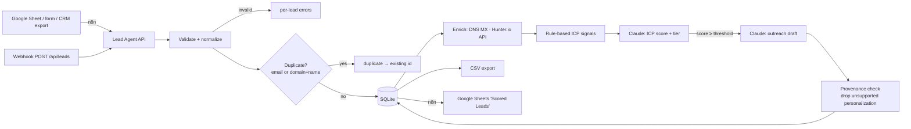

# AI Lead Generation Agent

Qualifies B2B leads you already have permission to process. It **validates and normalizes** lead data, **detects duplicates**, **enriches** from permitted sources only (public DNS MX records and the official Hunter.io API), **scores** each lead against your Ideal Customer Profile with **Claude**, drafts **personalized outreach** for good fits, and **exports to CSV or Google Sheets** (via n8n).

> Part of [Mawra Janjua's AI automation portfolio](https://github.com/Mawra-Janjua).

**What it does not do:** no web scraping, no LinkedIn scraping, no buying or guessing contact data, and no invented facts. Claude only sees fields you supplied or that came back from an enrichment API, and every outreach personalization must cite the field it came from. Personalizations that cite missing fields are removed.

## Features

| Stage | Details |
|---|---|
| Validation | Zod schema: company required, plus an email or website; employee count must be an integer; max 50 leads per request |
| Normalization | Lower-cased emails, domains extracted from URLs (`https://www.x.com/about` → `x.com`), names title-cased only when all-caps/all-lower (keeps `McDonald`), country aliases (`usa` → `United States`), free-mail detection (`gmail.com` is never treated as a company domain), LinkedIn URL check |
| Deduplication | Exact email, or company domain + person name; company-only leads (no name, no email) by website domain. Checked within the batch and against the database; keys are claimed atomically, so concurrent requests cannot create the same lead twice |
| Enrichment | DNS MX check (does the email domain accept mail?) · optional Hunter.io Company Enrichment + Email Verifier. Unknown stays `null`; provider errors are recorded, not hidden |
| Rate limits & retries | API rate limit per client, Hunter calls throttled, 15 s timeout, retried up to 2× on `429`/`5xx`/network errors (never other `4xx`); a Hunter failure is recorded in `enrichment.errors` and never fails the lead. Claude concurrency cap (`AI_CONCURRENCY`) + SDK retries |
| ICP scoring | Transparent rule-based signals (industry/size/country/title match) plus Claude score 0–100, tier A–D, reasons, risks, missing data |
| Outreach | Claude draft under 120 words for leads ≥ `OUTREACH_MIN_SCORE`, with per-sentence personalization provenance |
| Export | `GET /api/leads/export.csv` (formula-injection safe) · n8n Google Sheets workflows |
| Intake | REST API, n8n webhook (header auth), n8n hosted form, Google Sheet |

## Architecture



Details: [docs/ARCHITECTURE.md](docs/ARCHITECTURE.md).

## Quick start

Requires Node.js 22.18+.

```bash
npm install
cp .env.example .env               # set API_KEY, ANTHROPIC_API_KEY, SENDER_*
cp config/icp.example.json config/icp.json   # describe your ideal customer
npm start                          # http://127.0.0.1:4102
```

Generate an `API_KEY` (at least 16 characters) with:

```bash
node -e "console.log(crypto.randomUUID())"
```

By default the server listens on `127.0.0.1` only. If you set `HOST=0.0.0.0` (or any non-loopback address), it **refuses to start** without an `API_KEY`. Without a key on loopback, the API is open to this machine only (local development).

```bash
curl -X POST http://localhost:4102/api/leads \
  -H "content-type: application/json" -H "x-api-key: $API_KEY" \
  -d @test/fixtures/leads.json
curl -H "x-api-key: $API_KEY" http://localhost:4102/api/leads/export.csv -o leads.csv
```

Without `ANTHROPIC_API_KEY`, scoring requests return `503 ai_not_configured`; add `?score=false&outreach=false` to run validation, dedupe and enrichment only.

## Docker Compose

```bash
cp .env.example .env    # set API_KEY (required: the container listens on 0.0.0.0) and ANTHROPIC_API_KEY
docker compose up -d --build   # agent :4102, n8n :5678
```

The image and compose file set `HOST=0.0.0.0`, so the agent will exit at startup if `API_KEY` is missing or shorter than 16 characters. Generate one with `node -e "console.log(crypto.randomUUID())"`. Compose passes the same key to n8n as `LEAD_AGENT_API_KEY`.

## Configuration

See [.env.example](.env.example).

| Variable | Default | Purpose |
|---|---|---|
| `PORT` | `4102` | HTTP port |
| `HOST` | `127.0.0.1` | Listen address. Non-loopback requires `API_KEY` (Docker uses `0.0.0.0`) |
| `API_KEY` | — | Required `x-api-key` for `/api/*`; ≥ 16 chars. Mandatory unless `HOST` is loopback |
| `TRUST_PROXY` | `false` | `true` = rate-limit by `X-Forwarded-For`. Only behind a trusted reverse proxy |
| `RATE_LIMIT_PER_MINUTE` | `30` | API requests per client per minute |
| `MAX_BODY_BYTES` | `524288` | Max request body size |
| `DATABASE_PATH` | `./data/leads.db` | SQLite file |
| `ANTHROPIC_API_KEY` | — | Enables Claude scoring/outreach (otherwise `503 ai_not_configured`) |
| `CLAUDE_MODEL` | `claude-opus-5-5` | Model id |
| `CLAUDE_FALLBACKS` | `default` | `off` disables server-side refusal fallbacks |
| `AI_CONCURRENCY` | `2` | Parallel Claude calls per batch (1–10) |
| `ICP_FILE` | `./config/icp.json` | ICP definition (falls back to `config/icp.example.json`) |
| `OUTREACH_MIN_SCORE` | `60` | Minimum score for an outreach draft |
| `SENDER_NAME` / `SENDER_COMPANY` / `SENDER_OFFER` | placeholders | Used in outreach drafts |
| `HUNTER_API_KEY` | — | Optional Hunter.io enrichment |
| `HUNTER_MIN_GAP_MS` | `250` | Minimum gap between Hunter calls |
| `LEADS_SHEET_ID` | — | Google Sheet id, read by the n8n Sheets workflows |

### ICP file

```json
{
  "name": "Mid-market logistics",
  "description": "Companies with 50-1,000 employees in logistics or e-commerce ...",
  "targetIndustries": ["Logistics", "E-commerce"],
  "employeeRange": { "min": 50, "max": 1000 },
  "targetCountries": ["United States", "United Kingdom"],
  "targetTitles": ["Operations", "COO", "Founder"],
  "exclusions": ["Competitors offering automation services"]
}
```

### Hunter.io (optional)

Create a key at hunter.io → API. The agent calls `GET /v2/companies/find?domain=` and `GET /v2/email-verifier?email=`. Each lead uses up to two Hunter requests — check your plan's quota.

## n8n workflows

| File | Flow |
|---|---|
| `n8n/google-sheets-qualify.workflow.json` | Manual trigger → read **Leads In** → keep rows with an empty `Status` → batches of 50 → `POST /api/leads` → append only `created` leads to **Scored Leads** → write `Status` / `Lead agent note` / `Processed at` back to every submitted row (duplicates and invalid rows are reported there, not appended) |
| `n8n/webhook-intake.workflow.json` | `POST /webhook/lead-intake` (header auth; one lead or `{leads: [...]}`) → agent → respond with summary → append created leads to **Scored Leads**. Agent failure → `502` JSON error |
| `n8n/lead-form.workflow.json` | Hosted n8n form (Company required; Website, First/Last name, Email, Title, Country, Notes) → `POST /api/leads` → completion page shows the score/tier, "already received", the validation errors, or a clear error if the agent is unavailable |

**Import and configure**

1. In n8n: **Workflows → Import from File**, and pick each `n8n/*.workflow.json` (with Docker Compose they are also mounted read-only at `/workflows`).
2. **Create credentials** (none are shipped; every credential id in the JSON is empty):
   - **Google Sheets account** (Google Sheets OAuth2) and select it on every Google Sheets node.
   - **Lead Agent webhook auth** (Header Auth): pick a header name (e.g. `x-webhook-key`) and a long random value; select it on the **Lead webhook** node. Callers must send that header.
3. **Set n8n environment variables** (already done in `docker-compose.yml`): `LEAD_AGENT_URL` (e.g. `http://lead-agent:4102`), `LEAD_AGENT_API_KEY` (= the agent's `API_KEY`), `LEADS_SHEET_ID`. n8n must allow `$env` in expressions (`N8N_BLOCK_ENV_ACCESS_IN_NODE=false`).
4. Activate the webhook / form workflows. The form URL is shown on the **Lead form** node (`/form/lead-form`). The form completion page shows the ICP score to whoever submits it, so treat it as an internal intake form or edit the **Format result** node.

**Google Sheet layout**

- Tab **Leads In** — header row: `First name, Last name, Email, Title, Company, Website, Country, Industry, Employees, Notes, Status, Lead agent note, Processed at`. Leave `Status` empty for new rows; the workflow fills it with `created`, `duplicate`, `invalid` or `failed` and only re-reads rows whose `Status` is still empty. To re-submit a row, clear its `Status`.
- Tab **Scored Leads** — header row: `status, errors, duplicate_of, full_name, email, title, company, company_domain, country, score, tier, reasons, missing_data, outreach_subject, outreach_body, email_domain_accepts_mail, processed_at`.

**Retries are idempotent.** Every backend HTTP node retries 3× (3 s apart) and sends an `Idempotency-Key` (webhook: the caller's `Idempotency-Key` header or `n8n-webhook-<execution id>`; form: `n8n-form-<execution id>`; Sheets: sheet id + batch row range). If a first attempt timed out but the agent kept working, the retry gets the original results (`"replayed": true`, waiting for leads still being scored) instead of `duplicate`, so those leads still reach **Scored Leads**. Failed batches leave their Sheet rows un-marked so the next run picks them up with the same key.

## API

All `/api/*` routes need `x-api-key` (`API_KEY`). The only exception is local development: with no `API_KEY` the server only starts on a loopback `HOST`. Processing flags (query string, default `true`): `enrich`, `score`, `outreach`.

| Method & path | Description |
|---|---|
| `GET /health` | Public. Claude + enrichment provider status |
| `GET /api/icp` | Active ICP |
| `POST /api/leads/validate` | `{leads:[...]}` → normalization result per lead. Stores nothing |
| `POST /api/leads` | `{leads:[...]}` (1–50) → per-lead `created` / `duplicate` / `invalid` / `failed` + summary. Optional `Idempotency-Key` header (≤ 200 chars): re-sending the same batch with the same key returns the original results (`replayed: true`) instead of `duplicate` |
| `POST /api/analyze` | One lead, full pipeline, stores nothing (portfolio demo). `outreachSkipped` explains a missing draft (score too low, or `score=false`) |
| `GET /api/leads?tier=&minScore=&limit=` | List, highest score first |
| `GET /api/leads/:id` | One lead |
| `POST /api/leads/:id/rescore` | Re-run enrichment/scoring (e.g. after ICP change or failure) |
| `GET /api/leads/export.csv?tier=&minScore=` | CSV download (same `tier`/`minScore` validation as the list: `400` on bad input) |

## Testing

```bash
npm run typecheck
npm test
```

66 tests: normalization rules and edge cases; dedupe in-batch, against the DB, domain-only keys and concurrent requests (exactly one created); idempotent batch retries; enrichment (MX true/false/unknown, Hunter mapping, 429/5xx/network retry, no 4xx retry, timeout, failures never fail the lead); throttle spacing; batch processing with partial failures and retry; missing-Claude behaviour and `outreachSkipped` reasons; CSV quoting and formula-injection protection; HTTP layer (auth, loopback-only startup without a key, proxy handling, rate limits, security headers, malformed URLs); config defaults (`HOST`, `TRUST_PROXY`); HTTP integration (validation, export filters and headers, Idempotency-Key); real Anthropic SDK against a mock Messages API (prompt contents, PII minimization, score clamping, provenance filtering, and error mapping for refusal, truncation, invalid output, 5xx/overloaded, rate limit, auth, timeout); n8n workflow structure, empty credential ids, no embedded secrets, retry/error wiring, webhook header auth, the form and Sheets flows.

### Real execution test

The automated tests never call real APIs. To check the real pipeline end to end, run:

```bash
npm run live-check          # fixture #1 (BrightCart); or: npm run live-check -- 0
```

It qualifies **one** fictional lead from `test/fixtures/leads.json` with the real Claude API (plus Hunter.io only if `HUNTER_API_KEY` is set), stores nothing, and prints the enrichment, score, outreach draft and elapsed time. It **costs a small amount of Anthropic credit** (one scoring call, plus one outreach call if the score qualifies). Without `ANTHROPIC_API_KEY` it prints which variable is missing and exits with code 2. It never prints a made-up result.

Test data in `test/fixtures/leads.json` is fictional (reserved `.example` domains).

## Troubleshooting

See [docs/TROUBLESHOOTING.md](docs/TROUBLESHOOTING.md).

## License

MIT
