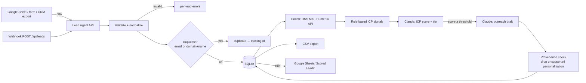

# AI Lead Generation Agent

Qualifies B2B leads you already have permission to process. It **validates and normalizes** lead data, **detects duplicates**, **enriches** from permitted sources only (public DNS MX records and the official Hunter.io API), **scores** each lead against your Ideal Customer Profile with **Claude**, drafts **personalized outreach** for good fits, and **exports to CSV or Google Sheets** (via n8n).

> Part of [Mawra Janjua's AI automation portfolio](https://github.com/Mawra-Janjua).

**What it does not do:** no web scraping, no LinkedIn scraping, no buying or guessing contact data, and no invented facts. Claude only sees fields you supplied or that came back from an enrichment API, and every outreach personalization must cite the field it came from. Personalizations that cite missing fields are removed.

## Features

| Stage | Details |
|---|---|
| Validation | Zod schema: company required, plus an email or website; employee count must be an integer; max 50 leads per request |
| Normalization | Lower-cased emails, domains extracted from URLs (`https://www.x.com/about` → `x.com`), names title-cased only when all-caps/all-lower (keeps `McDonald`), country aliases (`usa` → `United States`), free-mail detection (`gmail.com` is never treated as a company domain), LinkedIn URL check |
| Deduplication | Exact email, or company domain + person name; checked within the batch and against the database |
| Enrichment | DNS MX check (does the email domain accept mail?) · optional Hunter.io Company Enrichment + Email Verifier. Unknown stays `null`; provider errors are recorded, not hidden |
| Rate limits | API rate limit per client, Hunter calls throttled and retried on `429` with `Retry-After`, Claude concurrency cap (`AI_CONCURRENCY`) + SDK retries |
| ICP scoring | Transparent rule-based signals (industry/size/country/title match) plus Claude score 0–100, tier A–D, reasons, risks, missing data |
| Outreach | Claude draft under 120 words for leads ≥ `OUTREACH_MIN_SCORE`, with per-sentence personalization provenance |
| Export | `GET /api/leads/export.csv` (formula-injection safe) · n8n Google Sheets workflows |

## Architecture



Details: [docs/ARCHITECTURE.md](docs/ARCHITECTURE.md).

## Quick start

Requires Node.js 22.18+.

```bash
npm install
cp .env.example .env               # set API_KEY, ANTHROPIC_API_KEY, SENDER_*
cp config/icp.example.json config/icp.json   # describe your ideal customer
npm start                          # http://localhost:4102
```

```bash
curl -X POST http://localhost:4102/api/leads \
  -H "content-type: application/json" -H "x-api-key: $API_KEY" \
  -d @test/fixtures/leads.json
curl -H "x-api-key: $API_KEY" http://localhost:4102/api/leads/export.csv -o leads.csv
```

Without `ANTHROPIC_API_KEY`, scoring requests return `503 ai_not_configured`; add `?score=false&outreach=false` to run validation, dedupe and enrichment only.

## Docker Compose

```bash
cp .env.example .env && docker compose up -d --build   # agent :4102, n8n :5678
```

## Configuration

See [.env.example](.env.example). Key variables: `API_KEY`, `ANTHROPIC_API_KEY`, `CLAUDE_MODEL` (default `claude-opus-5-5`), `ICP_FILE`, `OUTREACH_MIN_SCORE`, `SENDER_NAME/COMPANY/OFFER`, `HUNTER_API_KEY`, `AI_CONCURRENCY`.

### ICP file

```json
{
  "name": "Mid-market logistics",
  "description": "Companies with 50-1,000 employees in logistics or e-commerce ...",
  "targetIndustries": ["Logistics", "E-commerce"],
  "employeeRange": { "min": 50, "max": 1000 },
  "targetCountries": ["United States", "United Kingdom"],
  "targetTitles": ["Operations", "COO", "Founder"],
  "exclusions": ["Competitors offering automation services"]
}
```

### Hunter.io (optional)

Create a key at hunter.io → API. The agent calls `GET /v2/companies/find?domain=` and `GET /v2/email-verifier?email=`. Each lead uses up to two Hunter requests — check your plan's quota.

## n8n workflows

| File | Flow |
|---|---|
| `n8n/google-sheets-qualify.workflow.json` | Manual trigger → read sheet **Leads In** → batches of 50 → `POST /api/leads` → flatten → append to **Scored Leads** |
| `n8n/webhook-intake.workflow.json` | `POST /webhook/lead-intake` (one lead or `{leads: [...]}`) → agent → respond with summary → append created leads to **Scored Leads** |

Set `LEAD_AGENT_URL`, `LEAD_AGENT_API_KEY`, `LEADS_SHEET_ID` in n8n's environment (done in `docker-compose.yml`) and select your Google Sheets credential on the Sheets nodes. **Leads In** columns: `First name, Last name, Email, Title, Company, Website, Country, Industry, Employees, Notes`.

## API

All `/api/*` routes need `x-api-key`. Processing flags (query string, default `true`): `enrich`, `score`, `outreach`.

| Method & path | Description |
|---|---|
| `GET /health` | Public. Claude + enrichment provider status |
| `GET /api/icp` | Active ICP |
| `POST /api/leads/validate` | `{leads:[...]}` → normalization result per lead. Stores nothing |
| `POST /api/leads` | `{leads:[...]}` (1–50) → per-lead `created` / `duplicate` / `invalid` / `failed` + summary |
| `POST /api/analyze` | One lead, full pipeline, stores nothing (portfolio demo) |
| `GET /api/leads?tier=&minScore=&limit=` | List, highest score first |
| `GET /api/leads/:id` | One lead |
| `POST /api/leads/:id/rescore` | Re-run enrichment/scoring (e.g. after ICP change or failure) |
| `GET /api/leads/export.csv?tier=&minScore=` | CSV download |

## Testing

```bash
npm run typecheck
npm test
```

34 tests: normalization rules and edge cases; dedupe in-batch and against the DB; enrichment (MX true/false/unknown, Hunter mapping, 429 retry, 404, 500); throttle spacing; batch processing with partial failures and retry; missing-Claude behaviour; CSV quoting and formula-injection protection; HTTP integration (auth, validation, export headers); real Anthropic SDK against a mock Messages API (prompt contents, PII minimization, score clamping, provenance filtering); n8n JSON structure.

Test data in `test/fixtures/leads.json` is fictional (reserved `.example` domains).

## Troubleshooting

See [docs/TROUBLESHOOTING.md](docs/TROUBLESHOOTING.md).

## License

MIT
